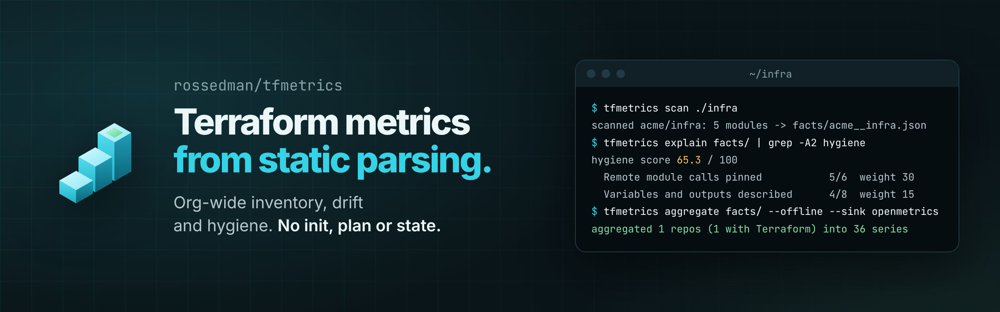

# tfmetrics

[](https://github.com/rossedman/tfmetrics/actions/workflows/ci.yml)
[](https://goreportcard.com/report/github.com/rossedman/tfmetrics)
[](https://github.com/rossedman/tfmetrics/releases/latest)
[](LICENSE)
[](https://rossedman.io/tfmetrics/)

Org-wide Terraform metrics from static parsing: inventory, version drift, module adoption and hygiene, without `terraform init`, plan or state.

tfmetrics reads the `.tf` files in your repos and emits one consistent set of metrics. It never runs Terraform, never touches state, and needs no cloud credentials. Point it at a directory, a git URL, or a whole GitHub org.

## Install

With Go:

```sh
go install github.com/rossedman/tfmetrics@latest
```

Or download an archive for Linux, macOS or Windows (amd64 and arm64) from the [releases page](https://github.com/rossedman/tfmetrics/releases/latest).

Every release is signed with cosign and carries build provenance. To verify a download:

```sh
cosign verify-blob checksums.txt \
  --bundle checksums.txt.sigstore.json \
  --certificate-identity-regexp '^https://github.com/rossedman/tfmetrics/.github/workflows/release.yml@refs/tags/v' \
  --certificate-oidc-issuer https://token.actions.githubusercontent.com
sha256sum --ignore-missing -c checksums.txt
gh attestation verify tfmetrics_*_linux_amd64.tar.gz --repo rossedman/tfmetrics
```

See [SECURITY.md](SECURITY.md) for details.

## Quick start

Scan a repo into a facts file, read the per-repo report, then compute metrics. This runs offline in a few seconds:

```console
$ tfmetrics scan ./infra
scanned acme/infra: 5 modules -> facts/acme__infra.json

$ tfmetrics explain facts/
acme/infra @ 084d5f2f6d15
owners: acme/platform

modules      5 (2 root, 3 child)
resources    8 declared, 1 data sources
module calls 8 (1 remote unpinned)
lines        194
parse errors 1

hygiene score 65.3 / 100
  Remote module calls pinned           5/6  weight 30
  Variables and outputs described      4/8  weight 15
  Providers with a version constraint  2/5  weight 15
  Roots with required_version          1/2  weight 15
  Variables with a type                3/4  weight 15
  Modules that parse cleanly           4/5  weight 10
...

$ tfmetrics aggregate facts/ --offline --sink openmetrics
aggregated 1 repos (1 with Terraform) into 36 series

$ grep -E '^tf_(hygiene_score|repos_total)' metrics/metrics.prom
tf_hygiene_score{org="acme",owner="acme/platform",repo="acme/infra"} 65.3
tf_repos_total{org="acme"} 1.0
```

The `explain` report continues with the module list, remote module calls and parse diagnostics. Drop `--offline` to also look up registry and git tags for version drift.

## Commands

| Command | What it does |
| --- | --- |
| `tfmetrics scan <path\|repo>...` | Parse local directories, git URLs or GitHub `owner/name` repos into facts JSON, one file per repo. With `--sink`, also aggregate and emit, which suits a per-repo PR check (`tfmetrics scan . --sink markdown`). |
| `tfmetrics org` | Discover repos in one or more GitHub orgs, apply name, topic and custom property filters, then shallow-clone and scan the matches in parallel. Unchanged repos reuse cached facts. |
| `tfmetrics aggregate <facts>...` | Compute the metrics catalog from facts files and write it to the sinks: `json`, `openmetrics`, `otlp`, `csv`, `parquet`, `markdown`. |
| `tfmetrics explain <facts>...` | Print a human-readable report per repo: inventory, hygiene score and its checks, remote module pinning, diagnostics. |

`tfmetrics version` prints the version, commit and build date. Run `tfmetrics <command> --help` for every flag.

## Configuration

Settings resolve in this order, highest first:

1. Command-line flags
2. Environment variables prefixed `TFMETRICS_`
3. The config file: `--config`, or `tfmetrics.yaml` in `$XDG_CONFIG_HOME/tfmetrics`, `~/.config/tfmetrics`, `$HOME` or the current directory

A small `tfmetrics.yaml` for scanning a GitHub org:

```yaml
source:
  github:
    token_env: GITHUB_TOKEN
    orgs:
      - name: acme
        include:
          topics: [terraform]
        exclude:
          names: ["sandbox-*"]
scan:
  concurrency: 16
  ignore_dirs: [.terraform, examples]
owners:
  property: team
sinks:
  - json: {path: metrics/}
  - openmetrics: {path: metrics/metrics.prom}
  - markdown: {}
```

With that file in place, `tfmetrics org --out facts/` followed by `tfmetrics aggregate facts/` scans the org and writes every sink listed.

## Metrics catalog

Metrics carry `org`, and per-repo metrics add `repo` and `owner` plus metric-specific labels.

| Metric | Meaning |
| --- | --- |
| `tf_repos_total` | Repos with at least one Terraform module |
| `tf_modules_total` | Module directories, by root or child |
| `tf_resources_declared` | Resource blocks declared |
| `tf_data_sources_declared` | Data source blocks declared |
| `tf_module_calls` | Calls to each module address and version |
| `tf_module_versions_behind` | Major or minor releases between the pinned version and the latest |
| `tf_module_calls_unpinned` | Remote module calls with no version or ref |
| `tf_provider_constraint` | Root modules per distinct provider version constraint |
| `tf_required_version` | Root modules per Terraform core version constraint |
| `tf_backend` | Root modules by backend type |
| `tf_variables_untyped` | Variables missing a type |
| `tf_variables_undescribed` | Variables missing a description |
| `tf_outputs_undescribed` | Outputs missing a description |
| `tf_prevent_destroy_resources` | Resources with `prevent_destroy = true` |
| `tf_module_lines` | Lines of Terraform configuration |
| `tf_parse_errors` | Files that failed to parse |
| `tf_hygiene_score` | Weighted 0-100 hygiene score |

## Documentation

Full guides, the command reference and the metrics catalog are at <https://rossedman.io/tfmetrics/>.

## Contributing

Contributions are welcome. Read [CONTRIBUTING.md](CONTRIBUTING.md), run `make check`, and report security issues through [SECURITY.md](SECURITY.md).

## License

Apache-2.0. See [LICENSE](LICENSE).
