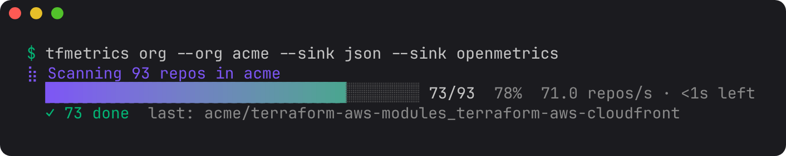
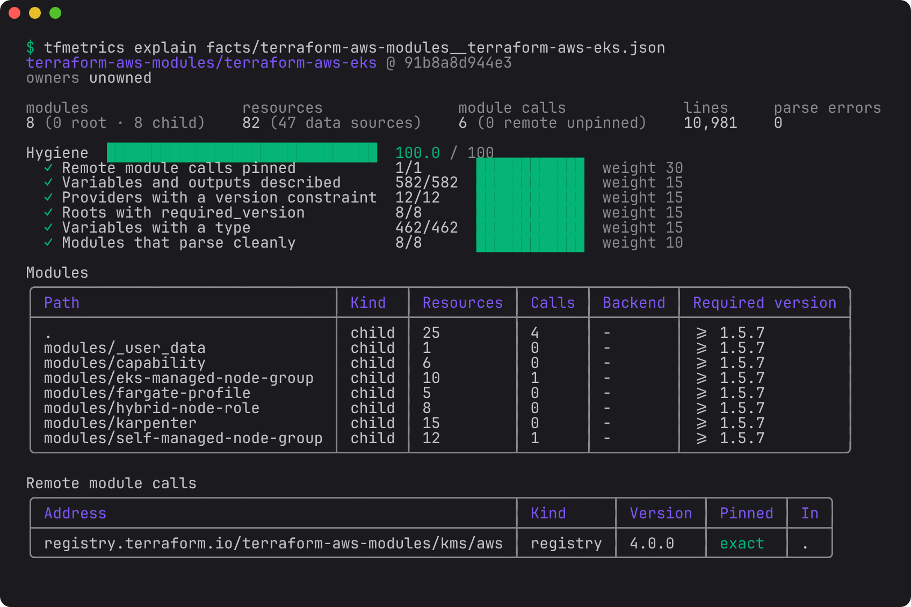

# Your first org audit

Find out what Terraform you have, which repos are in the worst shape and why, and who owns them. By the end you will have every repo ranked by hygiene, the specific problems behind each score, and a spreadsheet to share.

**Use this when** you inherit an estate, before a migration or a reorg, or as a regular health check. It needs no changes to any repo, nothing runs Terraform, and nothing touches state or cloud credentials.

## 1. Scan the repos

To follow along without your own org, scan six public repos. `scan` takes GitHub `owner/name` arguments and shallow-clones only their Terraform files, several at once:

```console
$ tfmetrics scan kubernetes/k8s.io alphagov/govuk-infrastructure \
    ministryofjustice/cloud-platform-infrastructure cisagov/cool-accounts \
    terraform-aws-modules/terraform-aws-eks 18F/cg-provision
scanned cisagov/cool-accounts: 9 modules -> facts/cisagov__cool-accounts.json
scanned terraform-aws-modules/terraform-aws-eks: 8 modules -> facts/terraform-aws-modules__terraform-aws-eks.json
scanned ministryofjustice/cloud-platform-infrastructure: 17 modules -> facts/ministryofjustice__cloud-platform-infrastructure.json
scanned alphagov/govuk-infrastructure: 49 modules -> facts/alphagov__govuk-infrastructure.json
scanned 18F/cg-provision: 82 modules -> facts/18F__cg-provision.json
scanned kubernetes/k8s.io: 97 modules -> facts/kubernetes__k8s.io.json
```

Each repo gets one facts file: everything tfmetrics learned, as JSON. Every later step reads these files, so you scan once and ask as many questions as you like.

For your own org, let `org` find the repos. Check what a filter selects before anything is cloned:

```console
$ export GITHUB_TOKEN=...            # read access to the org's repos
$ tfmetrics org --org acme --topic terraform --dry-run
$ tfmetrics org --org acme --topic terraform
```

On a terminal, `org` shows its progress as it goes; in CI it prints one line per repo instead.



## 2. Rank the repos

`aggregate` turns the facts into numbers. The `json` sink is easy to query with `jq`; the `csv` sink is for the spreadsheet in step 5. Leave out `--offline` so tfmetrics also looks up how far behind each module and provider is:

```console
$ tfmetrics aggregate facts/ --sink json --sink csv
warning: version lookup for app.terraform.io/govuk/infrastructure-sensitive/govuk//modules/wafs: 401 Unauthorized: ...
aggregated 6 repos (6 with Terraform) into 1316 series
```

The warning is a private registry tfmetrics has no token for. It leaves that one module's drift out and carries on.

Every repo has a hygiene score from 0 to 100. Lowest first:

```console
$ jq -r '.series[] | select(.name == "tf_hygiene_score") | "\(.value)\t\(.labels.repo)"' \
    metrics/metrics.json | sort -n
66      alphagov/govuk-infrastructure
70      cisagov/cool-accounts
72.6    18F/cg-provision
81.9    kubernetes/k8s.io
95.2    ministryofjustice/cloud-platform-infrastructure
100     terraform-aws-modules/terraform-aws-eks
```

The score is a weighted mix of six checks: pinned remote modules (weight 30), described variables and outputs, provider version constraints, `required_version` on roots, typed variables, and clean parses (15 or 10 each). The [metrics catalog](../reference/metrics.md#hygiene-score) has the formula, and [`hygiene.weights`](../configuration.md#hygiene) changes it.

## 3. Find out why a repo scores low

`explain` shows the checks behind one repo's score:

```console
$ tfmetrics explain facts/cisagov__cool-accounts.json
cisagov/cool-accounts @ c151add0c170
owners: dav3r,felddy,jsf9k,mcdonnnj

modules      9 (9 root, 0 child)
resources    118 declared, 75 data sources
module calls 46 (46 remote unpinned)
lines        5720
parse errors 0

hygiene score 70.0 / 100
  Remote module calls pinned           0/46     weight 30
  Variables and outputs described      186/186  weight 15
  Providers with a version constraint  9/9      weight 15
  Roots with required_version          9/9      weight 15
  Variables with a type                145/145  weight 15
  Modules that parse cleanly           9/9      weight 10

remote module calls
  ADDRESS                                                  KIND  VERSION  PINNED  IN
  github.com/cisagov/disable-inactive-iam-users-tf-module  git   -        none    audit
  github.com/cisagov/disable-inactive-iam-users-tf-module  git   -        none    dns
  ...
```

This repo is careful everywhere except one thing: none of its 46 module calls pins a version, so every `terraform init` takes whatever those modules' default branches hold that day. That one check is worth 30 points. Pinning the calls, with `?ref=v1.2.0` on a git source, takes the repo from 70 to 100.

On a terminal, `explain` draws the same report with tables and a score bar:



## 4. Find the biggest problems across all repos

Rankings tell you where to look; the individual metrics tell you what to fix. A few questions worth asking every audit:

**Which repos have the most unpinned module calls?**

```console
$ jq -r '[.series[] | select(.name == "tf_module_calls_unpinned")] | group_by(.labels.repo)
    | map("\(map(.value) | add)\t\(.[0].labels.repo)") | .[]' metrics/metrics.json | sort -rn
118     alphagov/govuk-infrastructure
46      cisagov/cool-accounts
2       kubernetes/k8s.io
0       terraform-aws-modules/terraform-aws-eks
0       ministryofjustice/cloud-platform-infrastructure
```

**Which module calls are furthest behind their latest release?**

```console
$ jq -r '.series[] | select(.name == "tf_module_versions_behind")
    | "\(.value)\t\(.labels.repo)\t\(.labels.address)"' metrics/metrics.json | sort -rn | head -4
122     ministryofjustice/cloud-platform-infrastructure registry.terraform.io/terraform-aws-modules/eks/aws
78      kubernetes/k8s.io                               registry.terraform.io/terraform-aws-modules/eks/aws
43      ministryofjustice/cloud-platform-infrastructure github.com/ministryofjustice/cloud-platform-terraform-monitoring
32      ministryofjustice/cloud-platform-infrastructure registry.terraform.io/terraform-aws-modules/vpc/aws
```

The value counts `major.minor` release lines between the version a call uses and the latest, so 122 means a long way behind. [Run a module upgrade campaign](upgrade-campaign.md) picks up from here, and [Keep providers and Terraform current](version-drift.md) does the same for providers.

**How does each owner's Terraform score?**

Owners come from each repo's `CODEOWNERS` file, a custom property, or a topic ([`owners`](../configuration.md#owners) decides which):

```console
$ jq -r '[.series[] | select(.name == "tf_hygiene_score")] | group_by(.labels.owner)
    | map({owner: .[0].labels.owner, repos: length, score: ((map(.value) | add) / length * 10 | round / 10)})
    | sort_by(.score) | .[] | "\(.score)\t\(.repos)\t\(.owner)"' metrics/metrics.json
66      1       alphagov/gov-uk-platform-engineering,alphagov/govuk-data-engineering,alphagov/national-data-library
70      1       dav3r,felddy,jsf9k,mcdonnnj
72.6    1       cloud-gov/platform-ops
91      2       unowned
95.2    1       ministryofjustice/WebOps
```

`unowned` repos have no owner tfmetrics could find. Giving them one is often the first fix an audit turns up.

## 5. Share the results

The `csv` sink wrote `metrics/modules.csv` (one row per module directory) and `metrics/module_calls.csv` (one row per module call). Open them in a spreadsheet to sort and filter, or ask them more questions. For example, the root modules that do not say which Terraform version they need:

```console
$ python3 -c "
import csv
rows = [r for r in csv.DictReader(open('metrics/modules.csv'))
        if r['kind'] == 'root' and r['required_version'] == '']
print(len(rows), 'roots without required_version')"
14 roots without required_version
```

For a written report per repo, add the [`markdown` sink](../sinks/markdown.md), and paste its output into a wiki page or an issue for each owner.

## Next steps

- Repeat the audit every night and watch the numbers move: [Nightly org scan](../guides/nightly-org-scan.md) and [Dashboards and trends](../guides/dashboards.md).
- Fix the drift you found: [Run a module upgrade campaign](upgrade-campaign.md).
- Stop new problems arriving: [Guardrails for pull requests](pr-guardrails.md).
