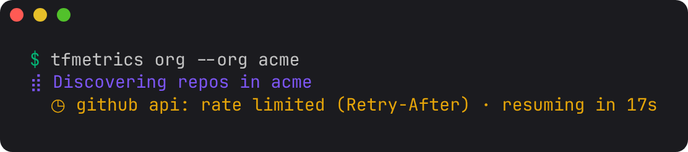
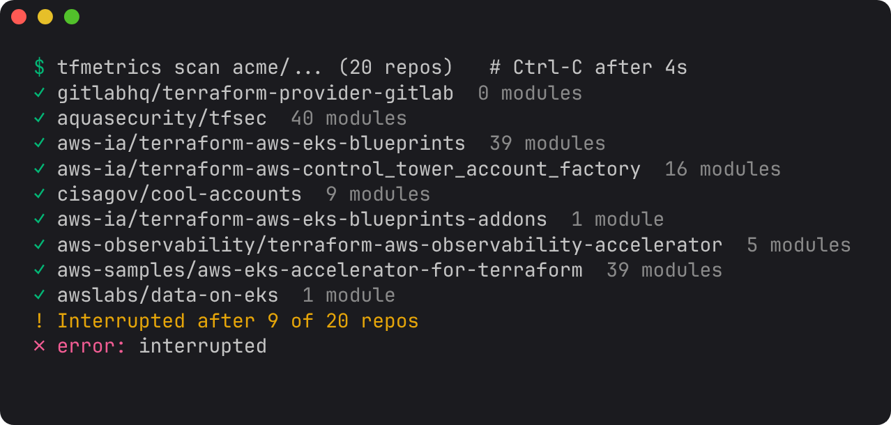

# Scan a large org fast

Scan hundreds or thousands of repos, or a few huge monorepos, in minutes, and keep the nightly run cheap. This tutorial covers what decides how long a run takes, and the settings that change it.

**Use this when** a first `tfmetrics org` run feels slow, when you are setting up a [nightly scan](../guides/nightly-org-scan.md) for a big org, or when your Terraform lives in monorepos with many modules each.

## Where the time goes

A run has four stages, and at org scale the network dominates:

| Stage | What it costs | What helps |
| --- | --- | --- |
| Discovery | A few GitHub API calls per 100 repos | Filters, so fewer repos are cloned at all |
| Cloning | One shallow, sparse clone per changed repo | The cache, and `--concurrency` |
| Parsing | CPU, spread over every core | Nothing to tune; `ignore_dirs` skips what you do not need |
| Version lookups | One registry or git call per distinct module and provider | `--offline` when you do not need drift |

For scale: on a 4-core machine, 93 public repos with 3,600 modules take about 14 seconds to clone and scan from scratch, 4 seconds to rescan from local checkouts, and 25 seconds to look up every module and provider version.

## 1. Scan only what you need

Every repo you filter out is a clone you never make. Filter on what your org already uses to mark Terraform repos: a topic, a naming pattern, or a [custom property](https://docs.github.com/en/organizations/managing-organization-settings/managing-custom-properties-for-repositories-in-your-organization):

```yaml title="tfmetrics.yaml"
source:
  github:
    orgs:
      - name: acme
        include:
          topics: [terraform]
        exclude:
          names: ["*-sandbox", "re:^archive-"]
```

Check what a filter selects before you clone anything. `--dry-run` lists the repos with their topics and properties:

```sh
tfmetrics org --dry-run
tfmetrics org --dry-run --json | jq length    # just the count
```

Archived repos and forks are skipped unless [`defaults`](../configuration.md#sourcegithub) says otherwise.

## 2. Let it run

On a terminal, `org` shows what it is doing: the repos found, then a progress bar with the scan rate and time left. If GitHub's rate limit pauses discovery, the view counts down to when it resumes, so a quiet minute does not look like a hang:



In CI, where output is not a terminal, every repo prints as a plain line instead (`scanned acme/tf-network`, `cached  acme/tf-dns`). Pass `--plain` to get those lines on a terminal too.

**Concurrency.** `org` clones and scans 16 repos at once. Cloning is mostly waiting on the network, so on a runner with good bandwidth, more is faster:

```sh
tfmetrics org --concurrency 32
```

Parsing needs no setting: each repo's modules are parsed on every core at once.

## 3. Rely on the cache

Each repo's facts are cached by its commit, together with a hash of the settings that affect them. Discovery already knows every repo's latest commit, so an unchanged repo costs no clone and no parse. The run's last line says how much the cache saved: `N repos: X scanned, Y from cache, Z failed`.

A typical nightly run only rescans the repos that changed that day. In GitHub Actions, persist the cache between runs with `actions/cache`, as [Nightly org scan](../guides/nightly-org-scan.md) does. Changing `ignore_dirs`, `root_overrides`, registry settings or the owner property rescans everything on the next run, automatically. `--no-cache` forces a full rescan once.

## 4. Stop and resume

Ctrl-C stops a run cleanly. Repos already scanned keep their facts files and their cache entries, and the command exits with status 130:



Run the same command again and it picks up where it stopped, because everything that finished is now in the cache:

```console
$ tfmetrics org --local-dir checkouts/ --org acme --concurrency 1
...
interrupted after 47 of 93 repos
error: interrupted
$ tfmetrics org --local-dir checkouts/ --org acme
93 repos: 46 scanned, 47 from cache, 0 failed -> facts
```

A second Ctrl-C exits at once, without waiting for in-flight clones.

## 5. Monorepos

One repo with hundreds of modules is fine: tfmetrics parses its modules in parallel. A few settings make the results match how you think about it:

- **Skip what is not infrastructure.** By default tfmetrics skips `examples`, `test`, `tests`, `testdata` and `.terraform` directories at any depth, plus hidden ones. Across 93 public repos, `testdata` alone held more than half of all module directories, all test fixtures. Add your own with [`scan.ignore_dirs`](../configuration.md#scan); setting it replaces the defaults, so list them again:

    ```yaml title="tfmetrics.yaml"
    scan:
      ignore_dirs: [.terraform, examples, test, tests, testdata, "sandbox/*"]
    ```

- **Mark roots tfmetrics cannot detect.** A directory is a root module when it declares a backend, a `cloud` block, or configures a provider. Stacks that get all of that from a wrapper, such as Terragrunt or a CI template, look like child modules. Name them with [`scan.root_overrides`](../configuration.md#scan), such as `stacks/*`.
- **Version each module separately.** If the monorepo tags each module (`vpc/v1.2.0`, `vpc-v1.2.0`), callers that pin those tags get drift measured against that module's own tags, not the repo's others. See [`tf_module_versions_behind`](../reference/metrics.md#tf_module_versions_behind).

## 6. Make failures visible

A repo that cannot be cloned is reported and skipped, and the run carries on: one broken repo should not cost you a whole night's metrics. If a nightly job should fail instead, add `--strict`, which exits non-zero when any repo fails to scan.

Lookups that fail during `aggregate`, such as a private registry with no token, print a warning and leave that series out. They never fail the run, and absence of a `*_versions_behind` series always means "unknown", never 0.
